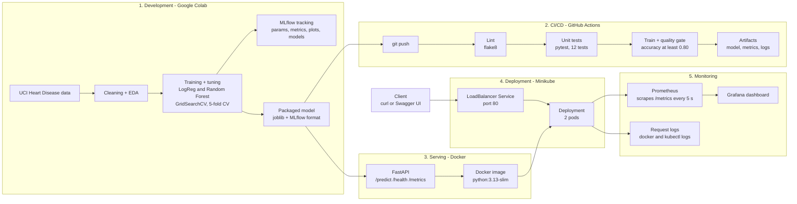

# Heart Disease Risk Prediction - End-to-End MLOps

MLOps Assignment 1 (AIMLCZG523). A classifier that predicts heart disease from 13 clinical
features (UCI Heart Disease, Cleveland), served as a monitored, containerised API.

## Repository structure

## Architecture


| Path | Contents |
|---|---|
| `scripts/download_data.py` | downloads the UCI data and writes the cleaned CSV |
| `data/heart_clean.csv` | cleaned dataset (303 patients, binary target) |
| `notebooks/` | 01 EDA, 02 model training + MLflow, 03 packaging + inference (Google Colab) |
| `src/heart_pipeline.py` | reusable cleaning + preprocessing pipeline and final model |
| `src/train.py` | training script used by CI (CV, test metrics, MLflow, quality gate) |
| `tests/` | pytest unit tests for data processing and model |
| `.github/workflows/ci.yml` | GitHub Actions: lint -> test -> train, with artifacts |
| `api/main.py`, `Dockerfile` | FastAPI service (`/predict`, `/health`, `/metrics`) and container |
| `k8s/` | Kubernetes Deployment, LoadBalancer Service, Ingress |
| `docker-compose.yml`, `monitoring/` | API + Prometheus + Grafana monitoring stack |
| `screenshots/` | screenshots used in the report |

## Setup
```bash
git clone https://github.com/2025ae05956/heart-disease-mlops.git
cd heart-disease-mlops
python -m venv .venv && source .venv/bin/activate   # Windows: .venv\Scripts\activate
pip install -r requirements.txt                       # Python 3.13
```

## Run the pipeline
```bash
python scripts/download_data.py      # get + clean data
python src/train.py                  # train, evaluate, log to MLflow (outputs/)
flake8 src tests                     # lint
pytest tests -v                      # unit tests
```
Notebooks run in Google Colab: upload the notebook and `data/heart_clean.csv`, then Runtime -> Run all.

## Docker
```bash
docker build -t heart-api .
docker run -d -p 8000:8000 --name heart-api heart-api
curl -X POST http://localhost:8000/predict -H "Content-Type: application/json" -d @sample_input.json
```
Example response:
`{"prediction":1,"label":"heart disease","probability_of_disease":0.9972,"confidence":0.9972}`
Interactive docs: http://localhost:8000/docs

## Kubernetes (Minikube)
```bash
minikube start --driver=docker --cni=bridge
minikube image load heart-api:latest
kubectl apply -f k8s/deployment.yaml -f k8s/service.yaml
minikube tunnel                       # in a second terminal
kubectl get svc heart-api             # use EXTERNAL-IP
curl http://<EXTERNAL-IP>/health
```

## Monitoring
```bash
docker compose up -d                  # API :8000, Prometheus :9090, Grafana :3000
python3 scripts/generate_traffic.py --n 200
```
Grafana: http://localhost:3000 -> dashboard "Heart Disease API Monitoring".

## API access
The API is not publicly hosted; run it locally with Docker or Minikube as above.

## Results
Selected model: Logistic Regression (C=1, class_weight=balanced).
5-fold CV ROC-AUC 0.908; test accuracy 0.869, recall 0.929, ROC-AUC 0.958.